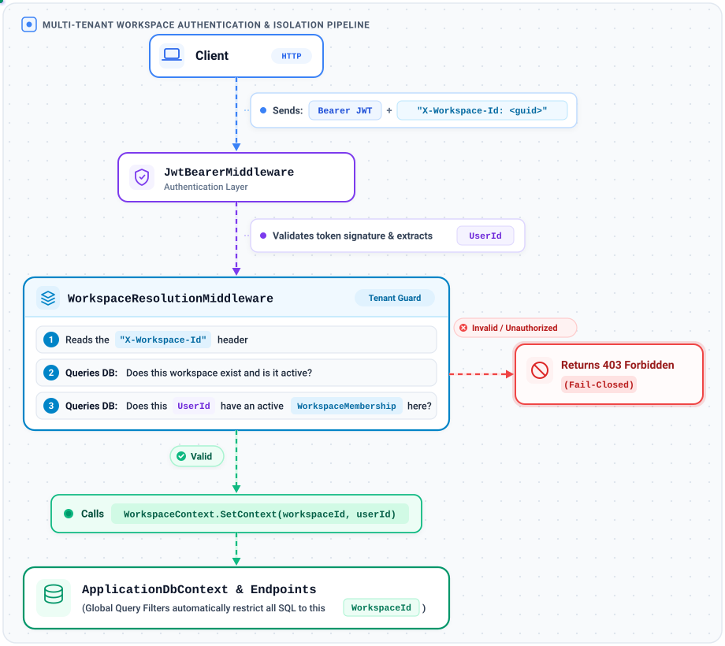
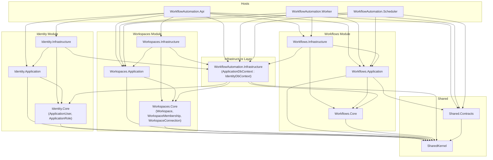
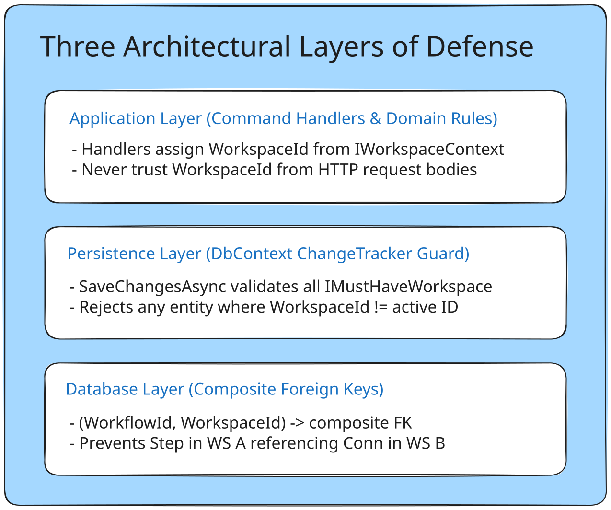

# Multi-Tenant Workflow Automation Platform

A .NET 10 modular monolith where workspaces create *DAG-based workflows* that execute asynchronously through RabbitMQ-driven background workers. Workflows are triggered by *webhooks*, *cron schedules*, or *manual execution*.

---

## Table of Contents

- [Architecture Overview](#architecture-overview)
- [Tech Stack](#tech-stack)
- [Project Structure](#project-structure)
- [What's Been Built](#whats-been-built)
- [Getting Started](#getting-started)
- [Running Tests](#running-tests)
- [Design Decisions](#design-decisions)
- [Implementation Roadmap](#implementation-roadmap)

---

## Architecture Overview

The platform is a *modular monolith* with three separate runtime hosts sharing a single PostgreSQL database. Modules communicate through *message contracts* over RabbitMQ via MassTransit. Workspace isolation is enforced at every layer through EF Core global query filters and per-request workspace context resolution.

```
┌──────────────────────────────────────────────────────────┐
│                     Client Application                    │
└────────────────────────┬─────────────────────────────────┘
                         │ HTTP + JWT Bearer + X-Workspace-Id
┌────────────────────────▼─────────────────────────────────┐
│                    API Host (ASP.NET Core)                 │
│   JWT Auth · Workspace Middleware · Bus Outbox             │
├───────────┬────────────┬─────────────────────────────────┤
│ Identity  │ Workspaces │  Workflows                       │
│ Module    │ Module     │  Module                          │
└─────┬─────┴─────┬──────┴──────┬──────────────────────────┘
      │           │             │
      ▼           ▼             ▼
┌──────────────────────────────────────────────────────────┐
│              RabbitMQ (via MassTransit)                    │
│         Commands · Events · Transactional Outbox          │
└────────────┬─────────────────────────┬───────────────────┘
             │                         │
┌────────────▼─────────┐  ┌────────────▼───────────────────┐
│    Worker Host        │  │      Scheduler Host             │
│  Saga State Machine   │  │  Quartz.NET Cron Jobs           │
│  Step Executors       │  │  Occurrence → StartExecution    │
│  Consumer Outbox      │  │  Bus Outbox                     │
└────────────┬─────────┘  └────────────┬───────────────────┘
             │                         │
┌────────────▼─────────────────────────▼───────────────────┐
│                   PostgreSQL 15                            │
│    EF Core · Saga State · Outbox · Identity Tables        │
└──────────────────────────────────────────────────────────┘
```

### Three Hosts

| Host | Type | Responsibility |
|:---|:---|:---|
| *API* | ASP.NET Core Web API | HTTP endpoints, JWT authentication, workspace resolution middleware, Bus Outbox publishing |
| *Worker* | .NET Worker Service | MassTransit consumers, saga state machine, step executors, Consumer Outbox with inbox deduplication |
| *Scheduler* | .NET Worker Service | Quartz.NET cron evaluation, deterministic occurrence identity, Bus Outbox publishing |

### Three Modules

| Module | Owns | Key Entities |
|:---|:---|:---|
| *Identity* | User accounts, authentication, JWT tokens | `ApplicationUser`, `ApplicationRole` |
| *Workspaces* | Workspace lifecycle, membership, connections | `Workspace`, `WorkspaceMembership`, `WorkspaceConnection` |
| *Workflows* | Workflow definitions, versioning, execution, DAG validation | `Workflow`, `WorkflowVersion`, `WorkflowExecution`, `WorkflowStepExecution` |

---

## Tech Stack

| Layer | Technology |
|:---|:---|
| *Runtime* | .NET 10 / C# |
| *Database* | PostgreSQL 15 (via Docker) |
| *Messaging* | RabbitMQ + MassTransit 8 |
| *Scheduling* | Quartz.NET |
| *ORM* | Entity Framework Core |
| *Authentication* | ASP.NET Core Identity + JWT Bearer |
| *Testing* | xUnit |
| *Containerization* | Docker / Docker Compose |

---

## Project Structure

The platform follows a *modular monolith* layout with clear module and host boundaries. Phase 1 migration from `DagWorkflow` to `WorkflowAutomation` is complete.

---
## Request Flow Overview



---
### Current State

```
WorkflowAutomation.slnx
├── src/
│   ├── Shared/
│   │   ├── WorkflowAutomation.Shared.Kernel/          # Primitives, Result<T>, Error, IClock, IWorkspaceContext, IMustHaveWorkspace (0 deps)
│   │   └── WorkflowAutomation.Shared.Contracts/       # Pure C# message contracts (Execution.Commands, Execution.Events)
│   │
│   ├── Infrastructure/
│   │   └── WorkflowAutomation.Infrastructure/         # ApplicationDbContext, Global Query Filters, Entity Configurations, DI registration
│   │
│   └── Modules/
│       ├── Identity/
│       │   └── WorkflowAutomation.Identity.Core/      # ApplicationUser : IdentityUser<Guid>, ApplicationRole
│       ├── Workspaces/
│       │   └── WorkflowAutomation.Workspaces.Core/    # Workspace, WorkspaceMembership, WorkspaceConnection, Enums
│       └── Workflows/
│           └── WorkflowAutomation.Workflows.Core/     # KahnDagValidator, Workflow models, DAG validation
│
└── tests/
    ├── WorkflowAutomation.Workflows.Core.Tests/       # 8 passing xUnit DAG tests
    └── WorkflowAutomation.Integration.Tests/          # 4 passing integration tests (Global Query Filters & DI Scoping)
```

### Target State

```
WorkflowAutomation.slnx

src/
├── Shared/
│   ├── WorkflowAutomation.Shared.Kernel/              # Result<T>, Error, IClock, Entity base, multi-tenancy interfaces
│   └── WorkflowAutomation.Shared.Contracts/           # Pure C# message records (no MassTransit refs)
│
├── Modules/
│   ├── Identity/
│   │   ├── WorkflowAutomation.Identity.Core/          # ApplicationUser : IdentityUser<Guid>
│   │   ├── WorkflowAutomation.Identity.Application/   # ITokenService
│   │   └── WorkflowAutomation.Identity.Infrastructure/ # JWT, Identity DI registration
│   │
│   ├── Workspaces/
│   │   ├── WorkflowAutomation.Workspaces.Core/        # Workspace, WorkspaceMembership, WorkspaceConnection
│   │   ├── WorkflowAutomation.Workspaces.Application/ # IWorkspaceService, IWorkspaceContext implementation
│   │   └── WorkflowAutomation.Workspaces.Infrastructure/ # Workspace EF configs, middleware
│   │
│   └── Workflows/
│       ├── WorkflowAutomation.Workflows.Core/         # Workflow, WorkflowVersion, DAG validation
│       ├── WorkflowAutomation.Workflows.Application/  # IWorkflowEngine, execution coordination
│       └── WorkflowAutomation.Workflows.Infrastructure/ # Saga, consumers, step executors
│
├── Infrastructure/
│   └── WorkflowAutomation.Infrastructure/             # ApplicationDbContext, outbox, migrations
│
└── Hosts/
    ├── WorkflowAutomation.Api/
    ├── WorkflowAutomation.Worker/
    └── WorkflowAutomation.Scheduler/

tests/
├── WorkflowAutomation.Workflows.Core.Tests/
├── WorkflowAutomation.Identity.Tests/
├── WorkflowAutomation.Workspaces.Tests/
├── WorkflowAutomation.Workflows.Application.Tests/
├── WorkflowAutomation.Worker.Tests/
└── WorkflowAutomation.Integration.Tests/
```

### Dependency Graph & Module Flow
---


<details>
<summary>View Mermaid Source Code</summary>



</details>

### Key Dependency Rules

- *Shared.Kernel (`WorkflowAutomation.Shared.Kernel`)*: Zero external NuGet dependencies. Pure .NET 10. The foundation that all Core and Application projects depend on.
- *Shared.Contracts (`WorkflowAutomation.Shared.Contracts`)*: Pure C# message records (commands and events). References only `Shared.Kernel`. Zero third-party dependencies (no MassTransit, EF Core, or ASP.NET Core).
- *Module Cores (`*.Core`)*: All module domain cores (`Identity.Core`, `Workspaces.Core`, `Workflows.Core`) depend strictly on `Shared.Kernel`. `Identity.Core` has a single lightweight NuGet dependency on `Microsoft.Extensions.Identity.Stores` (no EF Core).
- *Infrastructure Layer (`WorkflowAutomation.Infrastructure`)*: Hosts the unified `ApplicationDbContext : IdentityDbContext<ApplicationUser, ApplicationRole, Guid>`. References `Shared.Kernel`, `Identity.Core`, `Workspaces.Core`, and `Workflows.Core` to map entity configurations across all modules without coupling to application or business logic.
- *Module Application & Infrastructure Layers*:
  - `*.Application` depends on its respective `*.Core` and `Shared.Kernel` (`Workflows.Application` also references `Shared.Contracts`).
  - `*.Infrastructure` depends on its respective `*.Application`, `*.Core`, and `WorkflowAutomation.Infrastructure`.
- *Host Composition Roots*:
  - `WorkflowAutomation.Api`: References all module `Application` and `Infrastructure` layers (`IA`, `II`, `WSA`, `WSI`, `WA`, `WI`), `WorkflowAutomation.Infrastructure`, and `Shared.Contracts`.
  - `WorkflowAutomation.Worker`: References `Workflows.Application`, `Workspaces.Application`, `Workflows.Infrastructure`, `WorkflowAutomation.Infrastructure`, and `Shared.Contracts`.
  - `WorkflowAutomation.Scheduler`: References `Workflows.Application`, `Workspaces.Application`, `WorkflowAutomation.Infrastructure`, and `Shared.Contracts`.
- *Cross-module decoupling*: Cross-module entity references use raw `Guid` foreign keys only; never Entity Framework navigation properties between modules.
- *Strictly Acyclic Flow*: Every dependency path flows inward and terminates at `Shared.Kernel`. No circular references exist across modules or layers.
---

## Three Architectural Layers of Defense

To achieve complete tenant isolation on writes, modern systems use a defense-in-depth approach across **three** layers:



---

## What's Been Built

### 1. Shared Kernel (`WorkflowAutomation.Shared.Kernel`)
<details> 
<summary>details</summary>
A foundational domain library with *0 external NuGet package dependencies* (pure .NET 10). Provides:
- *Multi-Tenancy Scoping*: `IWorkspaceContext` and `WorkspaceContext` (thread-safe scoped context container with single-initialization invariant).
- *Tenant Marker*: `IMustHaveWorkspace` marker interface for automated EF Core global query filtering.
- *Domain Primitives*: `Entity<TId>`, `AuditableEntity<TId>`, and `IAuditableEntity` (`CreatedAt`, `UpdatedAt`).
- *Result Pattern*: `Result`, `Result<TValue>`, `Error`, and `ErrorType` enum (`Failure`, `Validation`, `NotFound`, `Conflict`).
- *Deterministic Time*: `IClock` and `SystemClock` for reliable unit testing.
</details>


*For complete class breakdowns and design details, see [src/Shared/WorkflowAutomation.Shared.Kernel/README.md](src/Shared/WorkflowAutomation.Shared.Kernel/README.md).*

### 2. Shared Contracts (`WorkflowAutomation.Shared.Contracts`)
<details>
<summary>details</summary>
Pure C# message contracts under `Execution.Commands` (`StartExecution`, `ExecuteStep`, `CancelStep`) and `Execution.Events` (`StepExecutionCompleted`, `StepExecutionFailed`, etc.) with `ExecutionSource`. Completely decoupled from MassTransit.
</details>

### 3. Identity Module Domain (`WorkflowAutomation.Identity.Core`)
<details>
<summary>details</summary>
- Domain user model: `ApplicationUser : IdentityUser<Guid>`
- Domain role model: `ApplicationRole : IdentityRole<Guid>`
</details>

### 4. Workspaces Module Domain (`WorkflowAutomation.Workspaces.Core`)
<details>
<summary>details</summary>
- *`Workspace` Aggregate Root*: Personal and Organization workspace types, explicit lifecycle management (`Active`, `Suspended`, `Archived`), and factory methods.
- *`WorkspaceMembership` Entity*: Scoped role management (`Owner`, `Admin`, `Member`, `Viewer`) decoupled from Identity via raw `Guid UserId`. Implements `IMustHaveWorkspace`.
- *`WorkspaceConnection` Entity*: Workspace-scoped external integration credentials boundary (`EncryptedCredentials`) keeping plaintext tokens out of workflow definitions. Implements `IMustHaveWorkspace`.
- *Domain Enums*: `WorkspaceType`, `WorkspaceStatus`, `WorkspaceRole`.
</details>

### 5. Workflows Module Domain (`WorkflowAutomation.Workflows.Core`)
<details>
<summary>details</summary>
- *Kahn DAG Validator (`KahnDagValidator`)*: Validates acyclic structure and computes topological execution orders using BFS queue traversal.
- *Domain Models*: `WorkflowDefinition`, `StepDefinition`, `WorkflowExecutionContext`, `DagValidationResult`.
</details>

### 6. Persistence & Multi-Tenancy Infrastructure (`WorkflowAutomation.Infrastructure`)

<details>

<summary>details</summary>
- *`ApplicationDbContext`*: Unified EF Core context inheriting `IdentityDbContext<ApplicationUser, ApplicationRole, Guid>`. Maps Identity, Workspaces, and Workflows schemas.

- *Fail-Closed Global Query Filters*:

  - `Workspace` aggregate root filtered by `w.Id == _workspaceContext.CurrentWorkspaceId` (primary key is `Id`, not `WorkspaceId`).
  - Workspace-owned entities (`WorkspaceMembership`, `WorkspaceConnection`) implementing `IMustHaveWorkspace` filtered by `e.WorkspaceId == _workspaceContext.CurrentWorkspaceId`.

  - When context is missing (`CurrentWorkspaceId == null`), EF Core translates the comparison to SQL `NULL`, which evaluates to false and safely returns 0 rows.

- *Entity Configurations*:

  - `WorkspaceConfiguration`: Maps table, property constraints, and restricts user foreign key cascade.
  - `WorkspaceMembershipConfiguration`: Composite primary key `(WorkspaceId, UserId)`, index on `UserId` for fast bootstrap resolution, `DeleteBehavior.Restrict`.

  - `WorkspaceConnectionConfiguration`: Unique composite index `(WorkspaceId, Name)` enforcing unique connection names per workspace, `DeleteBehavior.Restrict`.

- *Dependency Injection*:
  - `AddInfrastructurePersistence(connectionString)` registers `WorkspaceContext` (Scoped), forwards `IWorkspaceContext` to the same instance within the scope, and registers `ApplicationDbContext` with Scoped, unpooled lifetime using Npgsql PostgreSQL provider.
</details>

> [!IMPORTANT]
> *Tenant Isolation & Security Boundary Limits*:
> 1. *Read-Side Protection*: EF Core Global Query Filters automatically scope all queries to the active `CurrentWorkspaceId` (or fail closed to 0 rows).
> 2. *Write-Side Boundary*: Query filters do *not* inspect or protect write operations (`INSERT`, `UPDATE`, `DELETE`). Write-side isolation and cross-workspace reference checks must be strictly enforced in application services, aggregate invariants, and database foreign keys.

### 7. Test Suites (`tests/`)
<details> 

<summary>details</summary>

12 passing xUnit test cases across two test projects:
- *`WorkflowAutomation.Workflows.Core.Tests` (8 tests)*:
  - Empty workflows, linear dependency chains (A→B→C), diamond fan-out/fan-in graphs.
  - Disconnected valid subgraphs and single-node graphs.
  - Cyclic graphs, direct self-loops, and invalid/missing dependency references.
- *`WorkflowAutomation.Integration.Tests` (4 tests)*:
  - `GlobalQueryFilterTests`: Verifies fail-closed behavior (unauthenticated context yields 0 records) and cross-tenant isolation (Workspace A cannot see Workspace B data) on SQLite in-memory database.
  - `DependencyInjectionLifetimeTests`: Verifies `WorkspaceContext` and `IWorkspaceContext` resolve to the exact same reference within a scope, and that distinct scopes remain completely isolated.
</details>
---

## Getting Started

### Prerequisites

- [.NET 10 SDK](https://dotnet.microsoft.com/download)
- [Docker](https://www.docker.com/) (for PostgreSQL)

### Start Infrastructure

```bash
cd Multi-Tenancy-Workflow-Automation
docker compose up -d
```

This starts PostgreSQL on `localhost:5432` with:
- *User:* `postgres`
- *Password:* `password`
- *Database:* `multi_tenancy_db`

### Build

```bash
dotnet build WorkflowAutomation.slnx
```

---

## Running Tests

```bash
dotnet test WorkflowAutomation.slnx
```

All *12 tests* (8 DAG validation unit tests + 4 integration tests) should pass:
- `WorkflowAutomation.Workflows.Core.Tests`: 8 passed
- `WorkflowAutomation.Integration.Tests`: 4 passed

---

## Design Decisions: Problems Encountered & Solutions Chosen

### Implemented Decisions

| Area / Decision | Problem Encountered | Solution Proposed / Chosen | Architectural Rationale & Trade-offs |
|:---|:---|:---|:---|
| *Multi-Tenancy Query Isolation* | In a shared-database multi-tenant platform, relying on developers to write `.Where(x => x.WorkspaceId == ...)` on every query causes accidental cross-tenant data leaks. Root `Workspace` cannot have a foreign `WorkspaceId` filter. | Introduced `IMustHaveWorkspace` marker interface and `IWorkspaceContext`. In `ApplicationDbContext`, EF Core applies *Global Query Filters* automatically (`WHERE "WorkspaceId" = @CurrentWorkspaceId`) to all `IMustHaveWorkspace` entities and matches `w.Id` for the `Workspace` root. | Eliminates human error on read queries. Root `Workspace` aggregate intentionally omits the marker interface to prevent self-filtering conflicts. *Note: Global query filters only protect reads; write operations require explicit validation in application services and domain models.* |
| *Host-Agnostic Context Resolution* | Context (workspace and user identity) must be resolved across 3 distinct runtime hosts (API HTTP requests, Worker queue consumers, Scheduler cron jobs). Coupling context to `HttpContext` breaks non-web worker hosts. | Abstracted `IWorkspaceContext` in `Shared.Kernel`. Each host provides its own scoped implementation: API from JWT/header, Worker from message headers, Scheduler from job metadata. | Zero web dependencies in domain, persistence, or worker processes. Context is transparently available everywhere. |
| *Zero-Dependency Shared Kernel* | Shared libraries frequently become bloated "junk drawers" coupling modules through heavy third-party packages (EF Core, MassTransit, MediatR). | Enforced strict rule: *0 NuGet package dependencies* in `WorkflowAutomation.Shared.Kernel` (pure .NET 10). | Modules depend only on pure domain contracts and primitives without transitive package lock-in or version conflicts. |
| *Cross-Module Decoupling* | Entity Framework navigation properties across module boundaries (e.g., `WorkspaceMembership` referencing `ApplicationUser`) tightly couple database schemas and cause circular dependencies. | Cross-module relationships use raw `Guid` foreign keys only (e.g. `WorkspaceMembership.UserId` is a raw `Guid`). Cross-module interaction happens via contracts or application service interfaces. | Modules remain truly independent and can be refactored, split, or extracted into microservices without cascading schema breakage. |
| *Secret Isolation in Workflows* | Workflow DAG definitions are serialized, versioned, exported, and logged. Embedding plaintext integration tokens in step definitions leaks secrets. | `WorkspaceConnection` entity stores `EncryptedCredentials` scoped per workspace. Steps store only an opaque `ConnectionId`. | Workers resolve and decrypt credentials securely in-memory just-in-time during step execution; definitions stay clean of secrets. |
| *Error Handling & Control Flow* | Throwing C# exceptions for expected domain failures (validation errors, conflicts, state violations) degrades performance and conceals execution paths. | Functional Result Pattern via `Result`, `Result<TValue>`, `Error`, and `ErrorType` enum (`Failure`, `Validation`, `NotFound`, `Conflict`). | Explicit type-safe railway-oriented flow; straightforward mapping to HTTP status codes (400, 404, 409). |
| *Deterministic Time Abstraction* | Calling `DateTime.UtcNow` directly creates non-deterministic domain logic, making time-sensitive unit tests (expiry, locks, intervals) difficult to write and flaky. | `IClock` abstraction with default `SystemClock` for production and mockable implementations for tests. | Reliable, deterministic unit tests for time-critical workflows. |
| *Unified Database Context* | Managing separate DbContexts across modules requires distributed 2-phase commit transactions or leads to transaction fragmentation. | Single unified `ApplicationDbContext : IdentityDbContext` in `WorkflowAutomation.Infrastructure` sharing a single PostgreSQL database. | True ACID transactions across aggregates within the modular monolith. |

<details>
<summary>Planned Architectural Decisions (Phases 3–7)</summary>

| Area / Decision | Problem Encountered | Solution Proposed / Chosen | Architectural Rationale & Trade-offs |
|:---|:---|:---|:---|
| *Workflow Versioning* | Modifying an active workflow definition while executions are running causes non-deterministic behavior and broken state transitions. | Immutable `WorkflowVersion` entities with serialized definitions. Executions are strictly pinned to the version active at trigger time. | Guarantees auditability and determinism: in-flight executions never change behavior mid-run. |
| *Parallel Branch Failure* | In a parallel DAG, if one branch fails, continuing other branches wastes compute and risks running invalid downstream side effects. | Fail-fast saga orchestration. Saga stops dispatching new steps and requests cancellation of in-flight work. | Resource efficiency and consistency; waits for in-flight work to settle before marking execution failed. |
| *Distributed Three-Layer Cancellation* | Race conditions between step completion and cancellation; worker crashes during cancellation. | Three-tier architecture: (1) DB column `CancellationRequestedAt` with conditional UPDATE guard, (2) RabbitMQ broadcast as low-latency hint, (3) Worker-local `ConcurrentDictionary` tokens. | Resilient, at-most-once cancellation with durable recovery upon worker restart. |
| *Transactional Outbox & Inbox* | Dual-write hazard: database state commits but RabbitMQ message publish fails (or vice versa), leading to lost or duplicated steps. | MassTransit EF Core Outbox: Bus Outbox for API and Scheduler; Consumer Outbox with inbox deduplication for Worker. | Atomic database transactions and guaranteed at-least-once message delivery without message loss. |
| *Saga Concurrency* | Concurrent worker updates to the execution saga state machine cause lost updates or lock contention. | PostgreSQL `xmin` system column used for optimistic concurrency in `WorkflowExecutionSaga`. | High throughput without heavy distributed locks or dedicated saga database contexts. |

</details>

*For the complete technical analysis, sequence diagrams, and concurrency proofs of these planned phases, see [design_review.md](../design_review.md).*

---

## Implementation Roadmap

| Phase | Milestone | Status | Key Deliverables |
|:---|:---|:---:|:---|
| *1* | *Solution Structure & Core Migration* | ✅ Complete | Created `WorkflowAutomation.slnx`. Established `Shared.Kernel`, `Shared.Contracts`, `Workflows.Core`, `Identity.Core`, and `Workspaces.Core`. Verified all 8 unit tests pass. |
| *2* | *Identity, Workspaces & Multi-Tenancy Persistence* | 🟡 In Progress | `ApplicationDbContext` in `WorkflowAutomation.Infrastructure`, EF entity configurations (Workspace, Membership, Connection), Global Query Filters, DI registration, and passing integration tests. (EF migrations pending). |
| *3* | *Workflow & Version Persistence* | ⚪ Planned | `Workflow`, `WorkflowVersion` (immutable definitions), `WorkflowExecution`, `WorkflowStepExecution` (including `CancellationRequestedAt` and `CancellationReason` columns). |
| *4* | *API Idempotency & Bus Outbox* | ⚪ Planned | `IdempotencyRecord`. API-side Bus Outbox. Execution creation transaction with deduplication. |
| *5* | *Saga & Fail-Fast Orchestration* | ⚪ Planned | `WorkflowExecutionSaga`. `IWorkflowEngine` DAG step selector. Fail-fast cancellation and settling logic. Conditional UPDATE guard for `CancellationRequestedAt`. |
| *6* | *Worker Host & Step Executors* | ⚪ Planned | MassTransit worker host. Consumer Outbox. `IStepExecutor` interface. `LogStepExecutor`, `HttpStepExecutor`. Step executor idempotency keys (`{ExecutionId}:{StepId}:{AttemptNumber}`). |
| *7* | *Scheduler Host & Quartz.NET* | ⚪ Planned | Quartz.NET scheduled jobs. Deterministic occurrence identity. Misfire policies. |
| *8* | *API Endpoints & JWT Security* | ⚪ Planned | ASP.NET Core API host. JWT bearer auth. Workspace middleware. Workflow and execution endpoints. |
| *9* | *Integration Testing* | ⚪ Planned | Testcontainers (PostgreSQL + RabbitMQ). Concurrency, fail-fast, crash recovery, conditional UPDATE guards, Consumer Outbox atomicity, and workspace isolation tests. |
| *10* | *Compensation & Rollback (Future)* | ⚪ Planned | Compensating actions, `Compensating` saga state, compensation commands/events, reverse-dependency execution order, compensation retry policies. |
---

