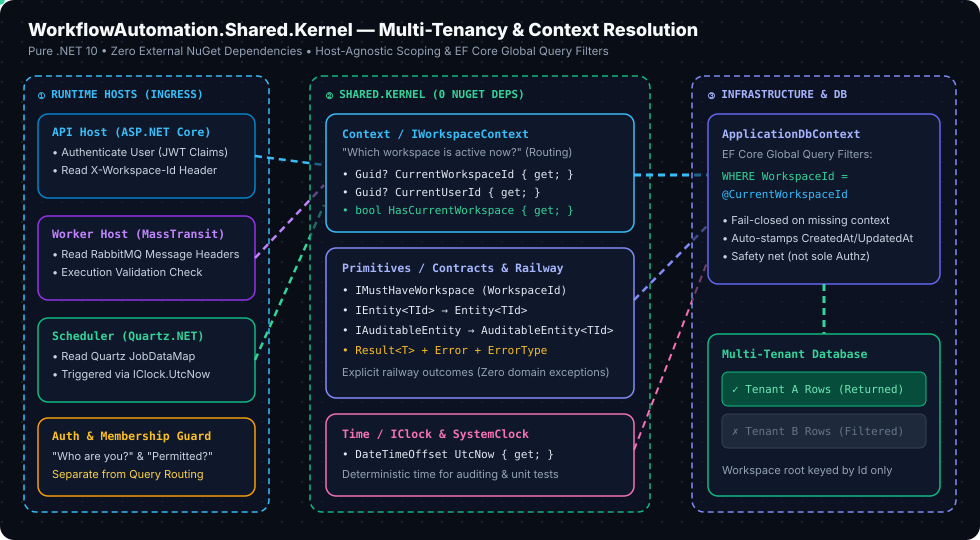

# WorkflowAutomation.Shared.Kernel

The Shared Kernel contains small, stable abstractions and primitives shared across modules. It should remain independent of EF Core, HTTP, message-bus libraries, and infrastructure implementations (strictly **zero external NuGet dependencies**, pure .NET 10).

---

  

---

## Architecture Flow: Multi-Tenancy & Context Resolution

```
                   USER SIGNS IN
                         |
                         v
                Authentication
                "Who are you?"
                         |
                         v
              Workspace Membership
              "Which workspaces
                may you access?"
                         |
                         v
                Select Workspace
                         |
                         v
               IWorkspaceContext
               "Which workspace
                is active now?"
                         |
                         v
                ApplicationDbContext
                         |
                         v
                Global Query Filters
                "Return only records
                 for this workspace"
                         |
                         v
                    Database
```

### Context vs. Authorization Boundaries

A workspace context is **not an authorization mechanism**—it is a **routing mechanism**. It tells the infrastructure layer which data belongs to whom. Authentication and authorization determine whether a user is even allowed to access that workspace.

```
IWorkspaceContext
    -> Which workspace is active?

Membership / Authorization Service
    -> Is this user allowed to perform this action?

ApplicationDbContext
    -> Apply workspace filters to ordinary queries.
```

| Concept | Responsibility |
|---|---|
| **Authentication** | Establish who the user is. |
| **Workspace membership** | Represent which users belong to which workspaces and their roles. |
| **Authorization** | Decide whether an action is permitted. |
| **Workspace context** | Identify the workspace for the current operation. |
| **Global query filters** | Automatically constrain ordinary queries to that workspace. |
| **Execution validation** | Verify that a background operation is valid before processing it. |

---

## 1. What It Contains & The Need for Each

### Context (`Context/`)

| Component | Type | Why It Is Needed |
| :--- | :--- | :--- |
| **`IWorkspaceContext`** | `Interface` | **Host-Agnostic Multi-Tenancy Scoping**: Exposes the workspace associated with the current operation (`CurrentWorkspaceId`, `CurrentUserId`, `HasCurrentWorkspace`) across any runtime host (API HTTP request, Worker message consumer, or Scheduler job) without tying consumers to `HttpContext` or a concrete domain entity. |

---

### Primitives (`Primitives/`)

| Component | Type | Why It Is Needed |
| :--- | :--- | :--- |
| **`IMustHaveWorkspace`** | `Interface` | **Global Query Filter Contract**: Marks an entity as belonging to a workspace by exposing `Guid WorkspaceId { get; }`. Infrastructure discovers implementing entities and configures automatic workspace query filters (`WHERE "WorkspaceId" = @CurrentWorkspaceId`). The `Workspace` root itself is not workspace-scoped; its identifier is `Id`. |
| **`IEntity<TId>`** | `Interface` | **Uniform Identity Contract**: Defines a generic unique identity (`TId Id { get; }`) for domain entities, allowing polymorphic handling. |
| **`Entity<TId>`** | `Abstract Class` | **Base Domain Entity**: Implements `IEntity<TId>` and encapsulates aggregate identity. Protects the `Id` setter, standardizes identity assignment, and provides a parameterless constructor required by EF Core for materialization. |
| **`IAuditableEntity`** | `Interface` | **Audit Trait Abstraction**: Exposes `DateTimeOffset CreatedAt { get; }` and `DateTimeOffset? UpdatedAt { get; }`. Enables EF Core interceptors or `SaveChangesAsync` overrides to automatically stamp creation and modification timestamps on any auditable entity before database writes. |
| **`AuditableEntity<TId>`** | `Abstract Class` | **Base Audited Aggregate**: Inherits `Entity<TId>` and implements `IAuditableEntity`. Eliminates boilerplate audit timestamp definitions across domain entities (`Workspace`, `WorkspaceMembership`, `WorkspaceConnection`, `Workflow`, etc.). |
| **`Result` & `Result<TValue>`** | `Class` | **Explicit Railway-Oriented Flow**: Encapsulates operation outcomes (`IsSuccess`, `IsFailure`, `Error`, `Value`). Replaces throwing exceptions for expected business failures, ensuring type safety and compile-time handling of failure paths. |
| **`Error`** | `Record` | **Structured Error Model**: Standardizes error representation with `Code`, `Description`, and `ErrorType`. Includes common factory methods (`NotFound`, `Validation`, `Conflict`, `Failure`) to map seamlessly to API status codes and event rejection reasons. |
| **`ErrorType`** | `Enum` | **Domain Failure Categorization**: Distinguishes error severity and semantics (`Failure = 1`, `Validation = 2`, `NotFound = 3`, `Conflict = 4`). |

---

### Time (`Time/`)

| Component | Type | Why It Is Needed |
| :--- | :--- | :--- |
| **`IClock`** | `Interface` | **Deterministic Time Abstraction**: Replaces direct calls to `DateTime.UtcNow`. Enables deterministic testing of time-dependent domain logic (e.g., token expiration, lock timeouts, audit timestamps, and scheduler cron intervals) by injecting test clocks. |
| **`SystemClock`** | `Sealed Class` | **Production Clock Implementation**: Implements `IClock` by returning real-time `DateTime.UtcNow`. Registered as a singleton in production dependency injection. |

---

## 2. Multi-Tenancy Design: Isolation & Context

### Problem: Workspace Data Isolation

In a single-tenant system, a database query can simply ask for `GetWorkflowById(id)` or `GetConnections()`. In our multi-tenant platform, a user can belong to multiple workspaces, each having completely isolated workflows, execution histories, and third-party credentials (API keys, OAuth tokens).

The core danger is _accidental tenant data leakage_. 

The platform is multi-tenant: a user may belong to multiple workspaces, and each workspace can own workflows, executions, connections, and other resources. We must avoid relying on developers remembering to add a `WorkspaceId` condition to every database query.

### Proposed Solution

```
[ Incoming Operation (HTTP / RabbitMQ / Cron) ]
                       │
                       ▼
 1. Authentication: "Who are you?" (Identity)
                       │
                       ▼
 2. Authorization: "Are you permitted to act in Workspace X?" (RBAC & Membership)
                       │
                       ▼
 3. Workspace Context: "Which workspace is active right now?" (Routing & Scoping)
                       │
                       ▼
 4. EF Core Global Query Filter: "Transparently append WHERE WorkspaceId = @ActiveWorkspaceId" (Safety Net)
                       │
                       ▼
 5. Storage / Execution Invariants: "Verify aggregate cross-references" (Entity Validation)

```


<b>Global Query Filters (GQF)</b> are a default automated safety net. They ensure that even if application-level code forgets a `Where(w => w.WorkspaceId == ...)` condition, the database engine will not return data from other workspaces.

<b>Global Query Filters are NOT our authorization layer.</b> Having a query filter does not tell us if a user should be allowed to delete a workflow, invite an admin, or decrypt a connection. That is handled by explicit authorization handlers.

Use EF Core global query filters as a default data-isolation mechanism, driven by a small workspace-context abstraction. Keep authorization checks separate: a workspace ID alone does not prove that a user or background operation is allowed to access that workspace.

#### `IMustHaveWorkspace`

<b>Problem It Solves</b>: Provides a generic compile-time marker for entities whose rows belong to a single workspace. This allows the EF Core infrastructure to automatically discover all workspace-scoped entities via reflection and configure global query filters without manually writing individual filter configurations for dozens of entity types.

#### `IWorkspaceContext` (proposed)

Exposes the workspace associated with the current operation, without tying consumers to an HTTP request or a concrete domain entity. The operation might be an API request, a RabbitMQ message consumer, or a scheduled job. The preferred initial design exposes IDs rather than a `WorkspaceMembership` object: membership represents a persisted relationship, while context represents the workspace in which an operation is running.

Whether `CurrentUserId` belongs in this interface remains a design decision. A background process may have an initiating user for auditing, but it is not necessarily executing as that user.

### Important Design Rules

- **Establish and validate context per operation**: Do not store mutable workspace state in a singleton or allow it to leak between messages/requests.
- **Fail closed on missing context**: A missing or invalid workspace context must fail closed for workspace-scoped operations. It must not silently disable filtering and expose all tenants' data.
- **Handle the membership resolution bootstrap**: Users need to retrieve their memberships before choosing an active workspace, but memberships may themselves be workspace-scoped. Provide a deliberate, narrowly scoped resolution path with explicit user/membership checks.
- **Safety net, not sole authorization**: Global query filters are a safety net, not a complete authorization boundary. Validate ownership and execution rules, especially for background messages and related entities.
- **Explicit cross-workspace operations**: Any cross-workspace operation must be intentional, authorized, and carefully scoped. Do not casually bypass filters.
- **No infrastructure leakage**: Keep domain entities and Shared Kernel abstractions free of EF Core and infrastructure dependencies. The infrastructure layer implements the persistence behavior.

### Intended Flow

1. **Authenticate the user** (for API operations).
2. **Resolve accessible workspaces** and validate the selected workspace.
3. **Establish the workspace context** for the operation.
4. **Let EF Core filters constrain ordinary queries** to that workspace.
5. **For Worker/Scheduler operations**, derive context from validated job or message data and validate referenced workspace-owned records before processing.

> *These abstractions and rules are the proposed design; confirm the context lifecycle, missing-context behavior, and membership-resolution strategy before implementing global query filters.*

---

<br>
### Workspace Lifecycle Across All Hosts
---

```
1. API REQUEST LIFECYCLE:
   [Client] ──(JWT + X-Workspace-Id)──> [Authentication Middleware]
                                                    │ (Validates JWT -> ClaimsPrincipal)
                                                    ▼
                                        [WorkspaceResolutionMiddleware]
                                                    │ Checks DB: Is user an active member?
                                                    │ Is workspace active?
                                                    ├── NOT Valid ──> 403 Forbidden (Halt)
                                                    └── Valid ──> Sets Scoped IWorkspaceContext
                                                                               │
                                                                               ▼
                                                                  [Endpoint / Application Logic]
                                                                               │
                                                                               ▼
                                                                  [ApplicationDbContext (GQF Applied)]

2. WORKER MESSAGE LIFECYCLE:
   [RabbitMQ] ──(ExecuteWorkflowStep)──> [MassTransit Consumer Scope]
                                                    │
                                                    ▼
                                         [Extract Message.WorkspaceId]
                                                    │
                                                    ▼
                                         [Bind Scoped IWorkspaceContext]
                                                    │
                                                    ▼
                                         [Load Execution Record from DB]
                                         (GQF ensures Execution belongs to Message.WorkspaceId)
                                                    │
                                                    ▼
                                         [Execute Step & Commit Outbox]
                                                    │
                                                    ▼
                                         [Dispose Scope (Context Cleared)]

3. SCHEDULER LIFECYCLE:
   [Quartz.NET Cron] ──(Fire Trigger)──> [Quartz Job Scope]
                                                    │
                                                    ▼
                                         [Extract JobDataMap.WorkspaceId]
                                                    │
                                                    ▼
                                         [Bind Scoped IWorkspaceContext (UserId = null)]
                                                    │
                                                    ▼
                                         [Validate Workspace & Workflow Active]
                                                    │
                                                    ▼
                                         [Insert ScheduledOccurrence & Outbox Message]
                                                    │
                                                    ▼
                                         [Dispose Scope (Context Cleared)]

```

## 3. Other Core Design Decisions

### 1. Multi-Host Context Resolution
- **Problem Encountered**: The platform consists of three distinct runtime hosts: API (ASP.NET Core), Worker (MassTransit consumers), and Scheduler (Quartz.NET). Domain and persistence layers need access to the current workspace and user, but referencing `IHttpContextAccessor` or `HttpContext` would tie background workers and schedulers to ASP.NET Core web abstractions.
- **Solution Proposed / Chosen**: Abstracted context access into `IWorkspaceContext` in `Shared.Kernel` with zero dependencies. Each host provides its own scoped implementation:
  - **API Host**: Reads JWT claims and the `X-Workspace-Id` HTTP request header.
  - **Worker Host**: Resolves workspace and user IDs from inbound RabbitMQ message headers.
  - **Scheduler Host**: Resolves workspace IDs from Quartz job data maps.

### 2. Shared Library Bloat ("Anti-Junk-Drawer")
- **Problem Encountered**: Shared libraries often devolve into "junk drawers" that pull in heavy third-party packages (EF Core, MediatR, MassTransit, ASP.NET Core). This causes transitive dependency lock-in, version conflicts, and leaky abstractions across isolated modules.
- **Solution Proposed / Chosen**: Enforced a strict rule: `WorkflowAutomation.Shared.Kernel` has **0 external NuGet package dependencies** (pure .NET 10). Foundational contracts remain pure C#, while infrastructure-specific adapters (EF Core configurations, MassTransit outbox, JWT middleware) remain strictly in their respective infrastructure projects.

### 3. Error Handling & Control Flow
- **Problem Encountered**: Using C# exceptions for anticipated domain failures (e.g., "Workspace name already taken", "Invalid state transition") degrades performance, clutters log files with false-alarm stack traces, and hides alternate execution branches from callers.
- **Solution Proposed / Chosen**: Adopted the **Result Pattern** (`Result`, `Result<TValue>`, `Error`, `ErrorType`). Domain methods express business failures explicitly through return types, enabling predictable railway-oriented programming and transparent status mapping at the API layer.

### 4. Time-Dependent Domain Logic Testing
- **Problem Encountered**: Direct usage of `DateTime.UtcNow` makes unit testing time-sensitive logic (auditing, membership expiration, cron triggers) non-deterministic and flaky without brittle monkey-patching.
- **Solution Proposed / Chosen**: Decoupled all time access behind the `IClock` interface. Domain entities and handlers receive `IClock`, allowing tests to supply fixed or fast-forwarded time implementations (`TestClock`) with zero production overhead.
